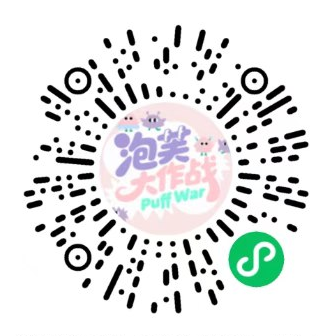

# 泡芙大作战 PuffWar 乐园：项目资料

这批资料用于 Twiink's Space 的项目介绍与后续选图，已接入画廊，正文与照片可在项目介绍中查看。

## 文字资料

- [确认版项目文稿](copy-draft.md)：本次确认的生活化文案归档。页面正文在 `src/data/content.json` 的 `projects` → `puffwar` → `details` 中编辑。
- [资料来源与核对记录](sources.md)：对应本地文档和源码，记录待确认的时间、场馆称呼与数据口径。
- [图片清单](asset-manifest.json)：四张原图及小程序码裁剪版的用途、尺寸、校验值和处理方式。

## 图片素材

| 文件 | 内容 | 当前处理 |
| --- | --- | --- |
| `originals/01-miniprogram-code.jpg` | 用户提供的微信小程序码截图 | 原文件完整保留 |
| `originals/02-play-area-collage.jpg` | 现场游玩拼图 | 原文件完整保留 |
| `originals/03-interactive-session.jpg` | 现场讲解与互动 | 原文件完整保留 |
| `originals/04-ball-pit.jpg` | 海洋球区实景 | 原文件完整保留 |
| `derived/miniprogram-code-cropped.png` | 裁剪后的小程序码 | 336 × 336，保留原有白底和码周围留白 |

小程序码仅去掉外围说明文字，码图范围没有缩放、重绘或修改像素。已验证裁剪范围的解码像素与原图一致；尚未通过微信实际扫码验证。

三张现场图中的既有模糊、遮挡、拼图和页码均保留，后续选图时再决定如何使用。

## 设计稿

[Figma：internship project 1 / 泡芙大作战小程序](https://www.figma.com/design/GbyoZsO44WHPza1s45PtiK/internship-project-1?node-id=977-282&p=f)

已在浏览器中打开并核对文件和页面，能看到小程序页面、原型及视觉设计。此处保存来源链接，未导出完整 `.fig` 文件，也不将设计稿默认归为个人独立设计成果。

## 当前状态

四张原图和裁剪版均已保存；画廊首项已接入已确认文案、三张现场图与小程序码。发布用文件在 `public/content/projects/puffwar/`，三张现场图和小程序码均按原字节复制。纸卡封面用 SVG 图框排版海洋球区照片，嵌入的是完整原图，渲染时保持照片比例；默认灰度显示，悬停后显色。

在 `/gallery` 翻转第一张纸卡，点击「查看项目」，或点击顶部「阅读项目介绍」。工具说明收在可展开的小节中。尚未提交 Git 或部署。
